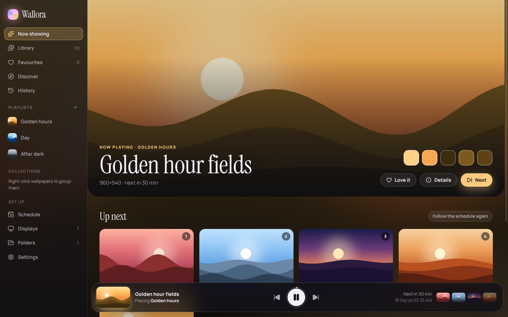
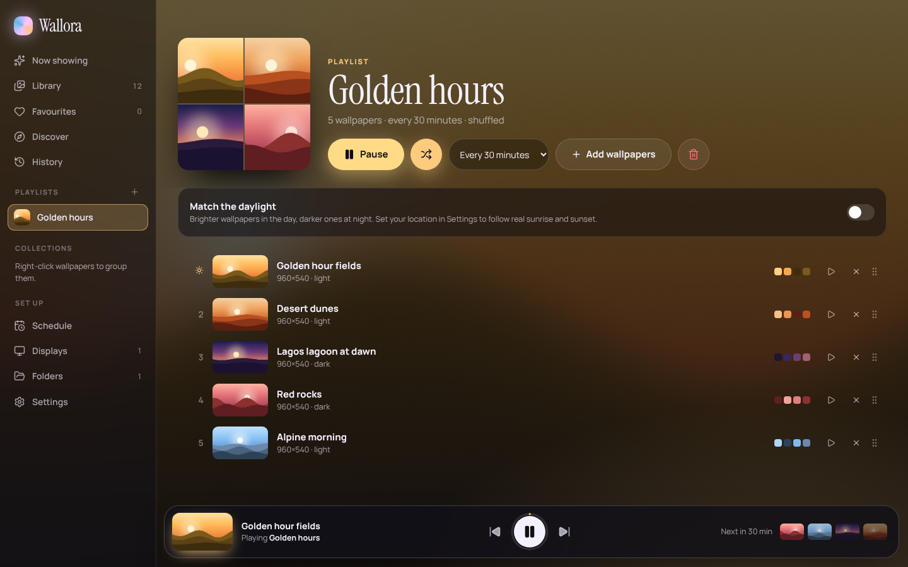
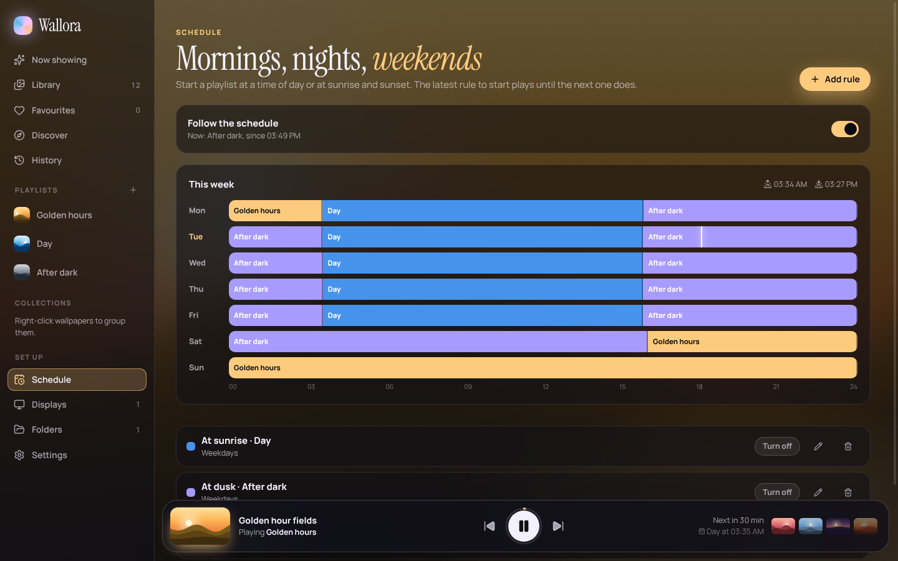
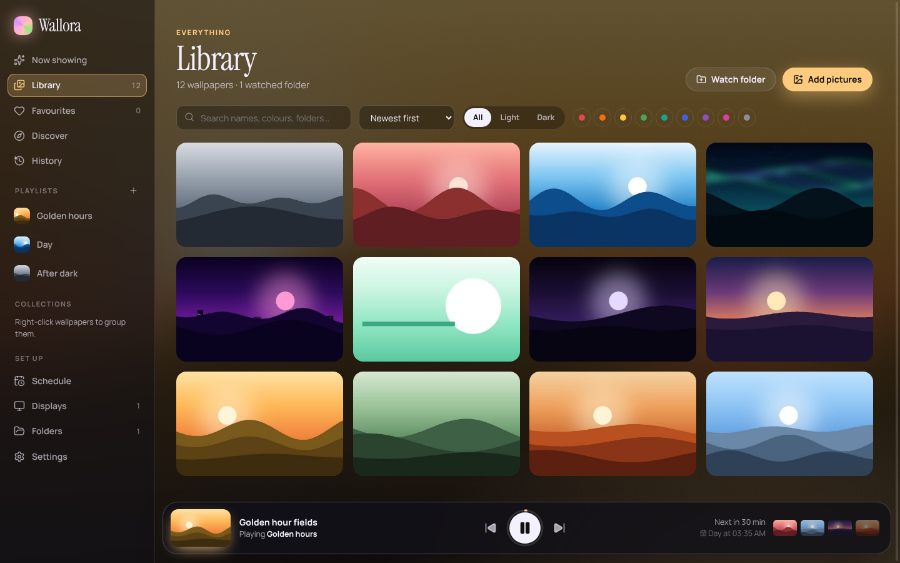
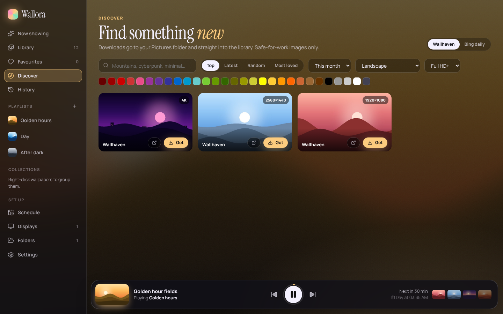
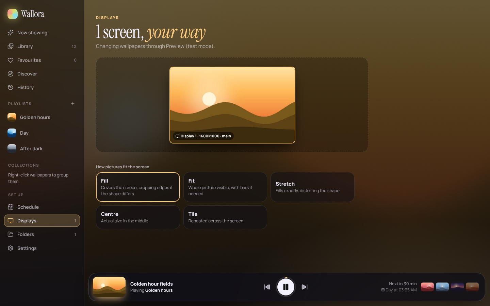

# Wallora

Wallora plays wallpapers the way a music app plays songs. Make playlists of your pictures, shuffle them, change every few minutes or once a day, and let a schedule switch to brighter pictures in the morning and darker ones after sunset. Give every monitor its own picture or its own playlist. Pull in new wallpapers from Wallhaven or Bing's photo of the day without leaving the app. And while a picture is on your desktop, the whole app takes on its colours.

A desktop app for **Windows** (its main target), **macOS** and **Linux**, built with Electron 44, React 19 and TypeScript, with the library in SQLite (`node:sqlite`, so there are no native modules to compile).

<p>
  
  
</p>

## Contents

- [What it does](#what-it-does)
- [Run it](#run-it)
- [Build installers](#build-installers)
- [How wallpapers get on the desktop](#how-wallpapers-get-on-the-desktop)
- [How playing works](#how-playing-works)
- [Architecture](#architecture)
- [Tests](#tests)
- [Data and privacy](#data-and-privacy)
- [Limits](#limits)
- [Project layout](#project-layout)

## What it does

**Library**
- **Watch a folder** (your Pictures folder, a wallpapers folder, with or without subfolders). New pictures appear by themselves; files deleted or moved outside Wallora are marked missing and come back if they return.
- **Add pictures**: pick files and Wallora keeps its own copy, so tidying the originals won't break anything. A picture that's already in the library is skipped (files are compared by hash, not name).
- Search by name, folder or colour; sort by newest, most shown, name, colour or brightness; filter light or dark pictures and by colour family.
- **Favourites** and **collections** (right-click any wallpaper, or select several).
- **Details**: a big preview, its colour palette, and how sharp it will look on each of your displays at the current fit.

**Playlists, like music**
- Make a playlist, add wallpapers, press play. In order or **shuffled** (every picture plays once before any repeats, and never the same one twice in a row).
- Change **every minute to once a week**. A countdown in the player bar shows when the next one comes, with the next four pictures lined up.
- **Previous / play-pause / next** from the player bar, the tray menu, or anywhere with **Ctrl+Alt+→**, **Ctrl+Alt+←** and **Ctrl+Alt+Space** (⌘⌥ on a Mac).
- **Smart playlists** fill themselves from rules: these collections, favourites only, these colours, light or dark, at least this wide, from these sources. They update as the library changes.
- **Match the daylight**: brighter wallpapers during the day and darker ones at night, following the real sunrise and sunset where you live.

**Schedule**
- Rules like "weekdays from sunrise, play **Day**", "every day at dusk, play **After dark**", "weekends from 16:00, play **Golden hours**".
- Times can be a clock time or **dawn, sunrise, sunset or dusk**, with an offset (for example 30 minutes before sunset). Sun times are worked out on your computer from the city you pick; nothing is looked up online.
- A **week chart** shows which playlist is in charge at every hour. The latest rule to start stays in charge until the next one does.
- Picking a playlist by hand overrides the schedule until the next rule starts. Or press **Follow the schedule again**.

<p>
  
  
</p>

**Multiple monitors**
- The **same** picture on every display, a **different** one on each (never the same picture twice at once), or a **playlist per display**.
- **Fill, fit, stretch, centre, tile** or **span** one picture across all screens.
- A map of your displays, laid out as they are, showing what's on each.

**Colours**
- Every picture's dominant colours are found when it's added, for filtering and smart playlists.
- **Colour from the wallpaper**: Wallora's accent colour and background glow follow the picture on your main display, so the app changes mood with your desktop (and can be turned off).

**Discover**
- **Wallhaven** search: top, latest, random or most-loved; by colour, time range, shape (landscape, ultrawide, portrait) and minimum resolution. **Safe-for-work only**. An optional Wallhaven API key can go in Settings.
- **Bing's photo of the day** for the last week.
- **Get** downloads a picture into your Pictures folder (or one you choose) and straight into the library, with a credit and a link back to where it came from. Things you already have are marked.

<p>
  
  
</p>

**History**: every change, with the time, the playlist it came from and the display, grouped by day. Double-click to bring one back.

**Running in the background**: closing the window keeps Wallora in the tray (or menu bar) so wallpapers keep changing. It can start when you sign in (hidden), and pause while a laptop is on battery. After sleep, it catches up straight away.

## Run it

You need Node 22.13+ (it uses `node:sqlite` for the tests).

```bash
npm ci
npm start            # builds and opens Wallora
npm run dev          # window with hot reload; Electron restarts when the main process changes
```

On Linux without a desktop session (a server, CI), run it under a virtual display: `xvfb-run -a npm start`.

## Build installers

```bash
npm run dist:win     # release/Wallora-1.0.0-x64.exe (installer), …-arm64.exe, and a portable .exe
npm run dist:mac     # release/Wallora-1.0.0-universal.dmg
npm run dist:linux   # release/Wallora-1.0.0.AppImage and a .deb
```

Build each on its own OS (Windows installers on Windows, the DMG on a Mac). The CI workflow does all three when you push a tag like `v1.0.0` and attaches them to the run. The configuration is in [`electron-builder.yml`](electron-builder.yml).

The installers aren't **code-signed**. Windows SmartScreen will warn on first run ("More info → Run anyway"), and macOS needs right-click → Open. To sign, give electron-builder a certificate (`CSC_LINK` / `CSC_KEY_PASSWORD`, plus Apple notarisation credentials on macOS); see the [electron-builder code-signing guide](https://www.electron.build/code-signing).

## How wallpapers get on the desktop

| System | How | Per monitor |
|---|---|---|
| **Windows 8–11** | The `IDesktopWallpaper` COM interface, through a short PowerShell script with a C# shim (no install, no admin). Monitors are matched to Electron's displays by their position and size in real pixels. | Yes, plus span |
| **macOS** | AppleScript through System Events (macOS asks once for permission to control System Events). | Yes, by desktop order |
| **Linux: GNOME, Cinnamon, Budgie, Unity** | `gsettings` (light and dark picture keys) | One picture for all |
| **Linux: KDE Plasma 5/6** | A Plasma shell script over `qdbus`/`qdbus6` | Yes |
| **Linux: Xfce** | `xfconf-query` on every monitor/workspace property | One picture for all |
| **Other X11 window managers** | `feh` (must be installed) | Yes |

Paths are passed to PowerShell base64-encoded and to every other command as separate arguments, never through a shell, so file names with quotes or spaces are safe. If a change fails, Wallora says why in the window and tries again a minute later.

## How playing works

`src/main/engine.ts` decides what plays; everything it relies on is pure and tested in `src/shared/`.

1. **Which playlist?** A playlist picked by hand (until the next schedule rule), else the schedule rule in charge (`schedule.ts`: the latest rule to have started over the past week, with sun times from `sun.ts`), else your whole library.
2. **Which picture?** `queue.ts` keeps a queue per display: in order, or a shuffled round where every picture plays once before a reshuffle, and a new round never starts with the picture that just played. With **different per display**, two screens never show the same picture at once. **Match the daylight** orders by brightness to suit the time of day.
3. **When next?** The sooner of the playlist's interval and the next schedule rule. The engine sleeps until then; waking from sleep, plugging in or a display change triggers a check straight away.
4. **Previous** steps back through what each display actually showed.

State (queues, what's on each display, pause) is saved in the database, so a restart picks up where it left off.

## Architecture

```
src/main/          Electron main process
  index.ts           window, tray, global shortcuts, IPC, the wallora:// protocol for thumbnails
  db.ts library.ts   SQLite schema and all reads/writes
  importer.ts        folder scanning and watching, imports, duplicate detection
  images.ts          decoding with Electron's nativeImage: size, 480 px thumbnail, palette
  engine.ts          the player (see above)
  setters/           Windows / macOS / Linux wallpaper setters, and the scripts they run
  online.ts          Wallhaven and Bing through Electron's network stack, safe downloads
src/preload/       the typed bridge (contextIsolation on, no Node in the window)
src/shared/        pure TypeScript: colours, sun, schedule, queue, smart rules, sources, displays, the API types
src/renderer/      React window: views/, ui/, store.ts
```

The window has no Node access: it calls a typed API (`src/shared/api.ts`) through the preload bridge, and the main process pushes a fresh snapshot when anything changes. Downloads only accept `https` links on Wallhaven's and Bing's image servers, must be JPEG or PNG under 80 MB, and are written to a `.part` file that's renamed only when complete.

## Tests

```bash
npm run typecheck
npm run lint
npm test                 # 19 unit tests (Node's test runner)
npm run build && npm run test:e2e   # 7 journeys through the real Electron app
```

The unit tests cover the colour palette and accent choice, sun times against published almanac values (London at midsummer, Lagos, Tromsø's midnight sun), schedule rules across days and weeks, queues and shuffling, smart rules and search, Wallhaven and Bing parsing, display matching and sharpness, script quoting, the SQLite library, folder scanning (new, deleted and returning files, duplicates) and the engine (intervals, previous, pause, schedule takeover, per-display playlists, failures, battery).

The journeys run the built app with its own data folder, a **fake desktop** that records what would have been set (`WALLORA_FAKE_DESKTOP`), a folder of sample pictures, and canned Wallhaven/Bing answers (`WALLORA_ONLINE_FIXTURES`), so they never touch your real wallpaper or the internet:
1. Watching a folder fills the library and starts changing the wallpaper; next, previous, pause.
2. Library search, colour filters, details, favourites, collections and removing.
3. Playlists: picking wallpapers, playing, interval and shuffle; a smart playlist of dark pictures.
4. Schedule rules taking over, the week chart, sunrise rules needing a location.
5. Discover: downloading from Wallhaven and Bing into the library.
6. Everything still there after a restart.
7. Adding pictures copies them and skips ones already in the library.

On Linux they need a display: `xvfb-run -a -s "-screen 0 1600x1000x24" npm run test:e2e`. CI runs the unit tests on Windows, macOS and Linux and the journeys on Linux.

## Data and privacy

- Everything lives in Wallora's app-data folder (`%APPDATA%\Wallora` on Windows, `~/Library/Application Support/Wallora` on macOS, `~/.config/Wallora` on Linux): `wallora.db` and a `thumbs/` folder. Your pictures stay where they are; added pictures are copied to `Pictures/Wallora/Imported` and downloads go to `Pictures/Wallora` (both can be changed in Settings).
- The only network requests are the ones you make in **Discover** (to wallhaven.cc and bing.com, and their image servers). Your location is used only on your computer.
- Downloaded pictures belong to their creators. Wallora keeps a credit and a link for each; check the terms before reusing them anywhere else.

## Limits

- Tested on Linux under a virtual display, with the desktop faked. The Windows, macOS and Linux setters follow each system's documented interface and their scripts are unit-tested, but **try it on a real Windows PC** before relying on it, especially with several monitors at different scaling.
- Picture formats: JPEG, PNG and BMP (what Electron decodes everywhere). WebP, HEIC and AVIF files are skipped.
- macOS numbers desktops in its own display order, so "a playlist per display" can land on a different screen than the map shows if you rearrange displays. Spaces each keep their own picture.
- GNOME and Xfce show one picture on all monitors, so "different per display" falls back to the same picture there.
- Unsplash isn't included: its API needs every app to register and show attribution in a particular way. Wallhaven and Bing need no account.
- `npm audit` lists advisories in development tools only (electron-builder's dependencies); none of it ships in the app, which bundles only its own code.

## Project layout

```
electron-builder.yml  eslint.config.js  playwright.config.ts  tsconfig.json  vite.config.ts
scripts/build.mjs      builds main + preload (esbuild) and the window (Vite); --dev for hot reload
resources/             app and tray icons
src/                   see Architecture
test/                  unit tests
e2e/                   Electron journeys, sample pictures, canned online answers
docs/screenshots/
```

## Licence

MIT. See [LICENSE](LICENSE).
